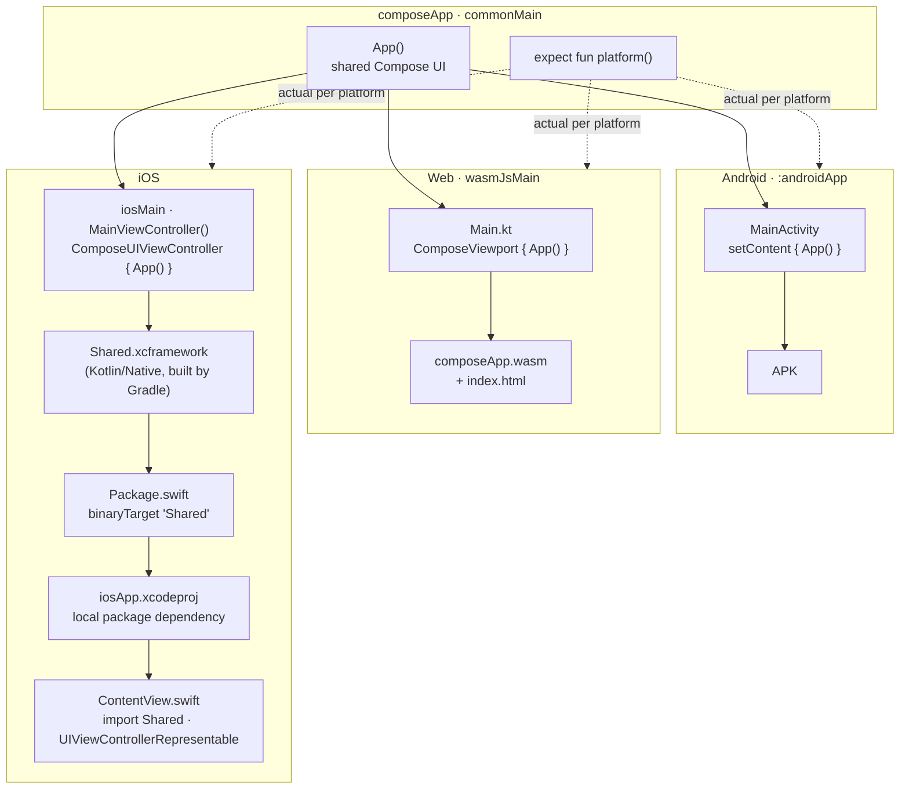
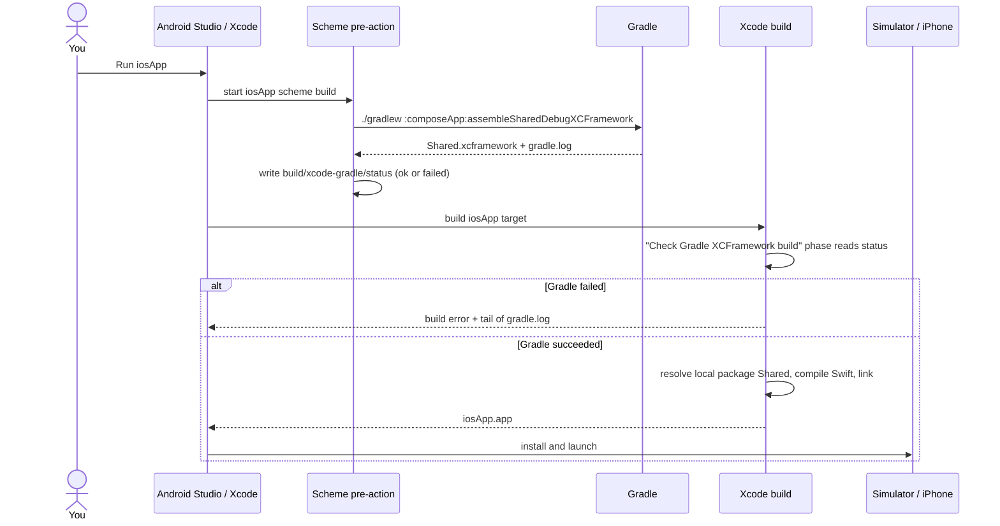
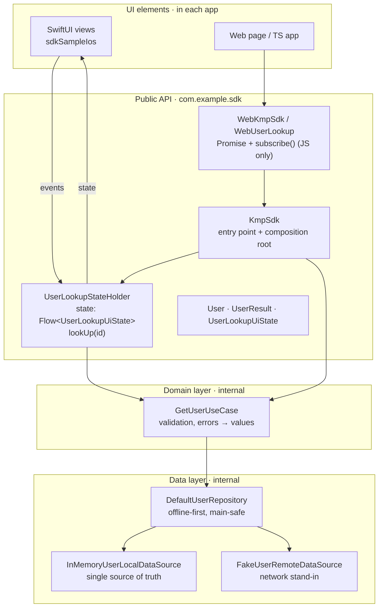

# kmp-spm

A small Kotlin Multiplatform + Compose Multiplatform demo that shares one Compose UI
across **Android**, **iOS**, and **Web (Wasm)**. On iOS, the shared Kotlin code is
delivered to Xcode as a **Swift Package Manager (SPM)** binary package, so the
project is named `kmp-spm`.

The app itself is a counter screen: it greets you with the current platform name
(for example `Hello from Android 35`, with the device's API level, or
`Hello from Web (Mozilla/5.0)`) and has a button that increments a count. The
point of the project is the build wiring, not the app.

The `sdk-swift-export` branch adds an experimental, reusable **SDK** (`:sdk`)
for iOS and Web. It uses Kotlin's Swift export instead of an Objective-C
framework, and its layers follow Android's app architecture guide. See
[Experimental SDK](#experimental-sdk-sdk).

## Architecture

One Compose UI in `commonMain` is compiled for three platforms. Each platform
adds only a thin entry point. On iOS, the Kotlin output goes through a Swift
Package before the app sees it.



### What happens when you run the iOS app

Xcode never calls Kotlin directly. The scheme rebuilds the XCFramework first,
then the normal Xcode build links it through SPM:



## Project layout

```
.
├── composeApp/                       # Shared KMP module (Android library, iOS framework, Wasm app)
│   └── src/
│       ├── commonMain/               # Shared Compose UI (App.kt) + expect fun platform()
│       ├── androidMain/              # actual platform() for Android
│       ├── iosMain/                  # MainViewController() bridge + actual platform()
│       └── wasmJsMain/               # Browser entry point (Main.kt) + index.html
├── androidApp/                       # Android application: MainActivity + AndroidManifest
├── sdk/                              # Experimental SDK for iOS (Swift export) and Web (npm package)
├── sdkSampleIos/                     # SwiftUI sample app that uses the SDK through Swift export
├── iosApp/
│   ├── iosApp/                       # SwiftUI shell that hosts the Compose view + Info.plist
│   └── iosApp.xcodeproj              # Xcode project with the iosApp scheme
├── Package.swift                     # Local SPM package wrapping the XCFramework
└── gradle/libs.versions.toml         # Every dependency and plugin version
```

- **Shared UI:** `App()` in `commonMain` is the whole UI. Each platform only
  provides an entry point and an `actual fun platform()`.
- **Android:** `composeApp` is an Android library
  (`com.android.kotlin.multiplatform.library`). The separate `:androidApp`
  module is the Android application: it depends on `:composeApp`, and its
  `MainActivity` calls `setContent { App() }`. This two-module layout is what
  AGP 9 requires for Kotlin Multiplatform projects.
- **Web:** the `wasmJs` target compiles `App()` to WebAssembly and serves it from
  `index.html`.
- **iOS through SPM:** the app links the Kotlin code as a prebuilt binary package:
  1. Gradle builds `composeApp/build/XCFrameworks/debug/Shared.xcframework`.
  2. The root `Package.swift` exposes that XCFramework as a binary target named `Shared`.
  3. `iosApp/iosApp.xcodeproj` depends on the repo root as a local package and
     does `import Shared`.
  4. `ContentView.swift` wraps the Kotlin `MainViewController()` in a
     `UIViewControllerRepresentable`, which is the `ComposeUIViewController { App() }`.

  The `iosApp` scheme has a pre-action that runs step 1 before every build, so
  Kotlin changes are picked up automatically. Xcode ignores pre-action failures,
  so the script records the result in `build/xcode-gradle/status`. The
  "Check Gradle XCFramework build" build phase then fails the build with the
  Gradle error if it failed. The full Gradle log is in `build/xcode-gradle/gradle.log`.

## Toolchain

| Component | Version |
| --- | --- |
| Gradle (wrapper) | 9.9.2 |
| Gradle daemon JDK | JetBrains JDK 21, auto-provisioned via the foojay resolver |
| Kotlin | 2.4.21 |
| Android Gradle Plugin | 9.5.2 |
| Compose Multiplatform | 1.12.2 (Material3 1.9.0) |
| Android compileSdk / targetSdk / minSdk | 37 / 37 / 24 |
| iOS targets | `iosArm64` (devices), `iosSimulatorArm64` (Apple Silicon simulators) |

All versions live in `gradle/libs.versions.toml`. You don't need a system-wide
Gradle or a specific JDK: the wrapper and the daemon toolchain settings
(`gradle/gradle-daemon-jvm.properties`) download what they need.

## Getting started

### Android

```sh
./gradlew :androidApp:installDebug
```

Or open the project in Android Studio and run the `androidApp` configuration.

### Web (Wasm)

**Development:** start a dev server with live reload:

```sh
./gradlew :composeApp:wasmJsBrowserDevelopmentRun
```

Then open http://localhost:8080 (the build prints the URL). In Android Studio,
use the `composeApp [wasmJs]` run configuration.

The build prints a long webpack summary. That's normal: it lists the bundled
files. The development build is unoptimized, so the files are large (about
19 MB for `composeApp.wasm`).

If a run reports failure right after a successful build, an earlier dev server
is probably still holding port 8080. Stop all `wasmJs` runs (or
`./gradlew --stop`) and start one fresh run. If the page looks stale, reload
with **⇧⌘R**.

**Production:** build an optimized bundle:

```sh
./gradlew :composeApp:wasmJsBrowserDistribution
```

The output goes to `composeApp/build/dist/wasmJs/productionExecutable/`:

| File | What it is | Size |
| --- | --- | --- |
| `index.html` | Page that loads the app | small |
| `composeApp.js` | Minified loader that starts the Wasm | ~0.5 MB |
| `<hash>.wasm` (from `composeApp.wasm`) | Your Kotlin code + Compose, optimized | ~2 MB |
| `<hash>.wasm` (from `skiko.wasm`) | Skia graphics engine used by Compose | ~8 MB |

The hashed file names change whenever the code changes, so browsers never use
a stale cached copy.

Webpack warns that these files exceed its "recommended size limit" (244 KB).
That limit is a rule of thumb for JavaScript and every Compose for Web app
exceeds it, so the warnings are safe to ignore.

**Deploying:** upload the whole `productionExecutable/` folder to any static
host (GitHub Pages, Netlify, Cloudflare Pages, S3, nginx, and so on). Two
requirements:

- Serve `.wasm` files with the `Content-Type: application/wasm` header.
  Browsers refuse to compile Wasm served with any other type.
- Turn on gzip or brotli compression. `.wasm` files compress very well, which
  cuts the download size substantially.

To check the production build locally before deploying, serve the folder with
any static server, for example:

```sh
python3 -m http.server 8000 -d composeApp/build/dist/wasmJs/productionExecutable
```

Then open http://localhost:8000. If the page stays blank, open the browser's
DevTools Network tab and check that the `.wasm` responses have type
`application/wasm`. The app also needs a browser with WebAssembly GC support:
current Chrome, Edge, Firefox, or Safari 18.2+.

### iOS

Requirements: a Mac with Xcode and its iOS platform component installed
(**Xcode ▸ Settings ▸ Components**, or `xcodebuild -downloadPlatform iOS`).

**First time only:** build the XCFramework once so Xcode can resolve the
`Shared` package when it opens the project:

```sh
./gradlew :composeApp:assembleSharedDebugXCFramework
```

After that, the scheme rebuilds it automatically.

**From Android Studio:** install the **Kotlin Multiplatform** plugin
(**Settings ▸ Plugins ▸ Marketplace**) and restart. Studio detects
`iosApp/iosApp.xcodeproj` and offers an `iosApp` run configuration. Pick a
simulator or a connected iPhone and click Run.

**From Xcode:** open `iosApp/iosApp.xcodeproj`, select the `iosApp` scheme and a
destination, and run.

**From the command line:**

```sh
xcodebuild -project iosApp/iosApp.xcodeproj -scheme iosApp \
  -destination 'platform=iOS Simulator,name=iPhone 17' build
```

To run on a physical iPhone, choose your Apple ID team under **Signing &
Capabilities** in Xcode first. The checked-in project has no team set.

For a release build, run `assembleSharedReleaseXCFramework` and change `debug`
to `release` in `Package.swift`. The scheme pre-action always builds debug.

## Experimental SDK (`:sdk`)

`:sdk` is a logic-only Kotlin Multiplatform library with no Compose, meant to
be consumed by native apps:

- **iOS:** built through **Swift export** (Alpha in Kotlin 2.4). Kotlin code
  becomes a real Swift module named `KmpSdk`, not an Objective-C framework.
  `suspend` functions become `async`, `Flow` becomes `AsyncSequence`, and
  sealed classes become Swift enums you can `switch` over exhaustively.
- **Web:** a Kotlin/JS library packaged for npm as `kmp-sdk`, with ES modules
  and TypeScript definitions.

The sample feature looks up a user by id, using fake data.

### Layers

The structure follows Android's
[Guide to app architecture](https://developer.android.com/topic/architecture).
The SDK holds the data and domain layers plus a shared UI state holder.
Each app keeps only its native UI.



| Layer | Classes | Responsibility |
| --- | --- | --- |
| UI: state holder | `UserLookupStateHolder`, `UserLookupUiState` | Owns screen state, receives events (unidirectional data flow). The shared equivalent of a ViewModel. |
| Domain | `GetUserUseCase` | Business rules: trims and validates input, and turns every outcome (including errors) into a `UserResult`. |
| Data | `UserRepository`, `DefaultUserRepository` | Exposes user data, caches it, and moves work off the main thread. |
| Data sources | `UserRemoteDataSource`, `UserLocalDataSource` | Each one talks to exactly one source. The local store is the single source of truth. |

Design rules:

- **Expose as little as possible.** Only the types in `com.example.sdk` are
  public. `domain` and `data` are `internal`, and `explicitApi()` makes every
  public declaration deliberate. Keeping the public types in one package also
  gives Swift short names (`KmpSdk.UserResult`, not a long package path).
- **Manual dependency injection.** `KmpSdk` wires the graph through
  constructors. Hilt is Android-only, and a DI framework would leak into the
  Swift and JavaScript APIs. Tests inject fakes through `internal`
  constructors.
- **Errors are values.** `UserResult.Failure` and `UserLookupUiState.Error`
  reach Swift as enum cases and JavaScript as classes. Apps never need to
  catch Kotlin exceptions.
- **Swift-friendly types.** Public classes are final, results are sealed, and
  the public API has no generics or custom collections. Kotlin `Int` is
  `Int32` in Swift.
- **JS needs a thin adapter.** JavaScript can't call `suspend` functions or
  collect a `Flow`, so `jsMain` adds `WebKmpSdk` and `WebUserLookup`. They
  return Promises and offer `subscribe(callback)`, which returns an
  unsubscribe function.

To add a real backend, implement `UserRemoteDataSource` with Ktor. For
persistence across launches, implement `UserLocalDataSource` with SQLDelight
or Room KMP. Nothing above the data layer changes.

### Using it from Swift

```swift
import KmpSdk

let sdk = KmpSdk()                         // one per app
let result = try await sdk.getUser(id: "2") // suspend → async
switch result.sealedType() {                // sealed → exhaustive enum
case .found(let f):    print(f.value.user.name)
case .notFound(let n): print("no user \(n.value.id)")
case .failure(let e):  print(e.value.message)
}

let lookup = sdk.createUserLookup()
for try await state in lookup.state.asAsyncSequence() { /* render */ }
```

### Using it from TypeScript / JavaScript

```ts
import { WebKmpSdk, UserResult } from "kmp-sdk";

const sdk = new WebKmpSdk();
const result = await sdk.getUser("2");
if (result instanceof UserResult.Found) console.log(result.user.name);

const lookup = sdk.createUserLookup();
const unsubscribe = lookup.subscribe(state => console.log(state.toString()));
lookup.lookUp("3"); // Idle → Loading(id=3) → Success(...)
```

### Building and testing

```sh
./gradlew :sdk:allTests                               # iOS simulator, Node and browser
./gradlew :sdk:jsBrowserProductionLibraryDistribution # npm package
```

The npm package lands in `sdk/build/dist/js/productionLibrary/`
(`package.json`, `kmp-sdk.mjs`, `kmp-sdk.d.mts`). Run `npm publish` from that
folder, or `npm install <path>` it into a web app.

For iOS, open `sdkSampleIos/SdkSample.xcodeproj` and run the `SdkSample` scheme.
Its first build phase runs `./gradlew :sdk:embedSwiftExportForXcode`, which
compiles the SDK and puts the generated `KmpSdk` Swift module into Xcode's
build products. Try ids `1`–`3`, an unknown id, or `error` (a simulated
network failure).

### Swift export limitations (Kotlin 2.4)

- **iOS 18 minimum.** The generated coroutine support uses Swift's `Mutex`, so
  `async` and `Flow` interop require iOS 18.
- **The app has to build the SDK itself.** The only supported setup is direct
  integration: the app's Xcode project runs Gradle (`embedSwiftExportForXcode`).
  There's no supported way yet to ship a prebuilt XCFramework or Swift package
  to other teams. Gradle does generate an SPM package internally
  (`sdk/build/SPMPackage/`), and Kotlin 2.5 reworks the export DSL with
  publishing in mind.
- **Apple Silicon simulators only.** The sample excludes `x86_64` for the
  simulator.
- **Alpha.** Expect breaking changes. Generic types are erased, and types that
  inherit from `List`, `Set` or `Map` aren't exported.

## Known limitations

- **Compose requires `CADisableMinimumFrameDurationOnPhone`.** Compose
  Multiplatform aborts at launch if the iOS app's `Info.plist` doesn't set this
  key to `true`. `iosApp/iosApp/Info.plist` sets it, so keep it if you
  regenerate the Xcode project.
- **No Intel-Mac iOS simulator.** Compose Multiplatform 1.12 no longer publishes
  `iosX64`, so the target was removed. Use an Apple Silicon Mac or a real device.
- **Kotlin plugin warning about Gradle 10.** Kotlin 2.4.x triggers a Gradle 10
  incompatibility warning (`KotlinNativeBundleArtifactsTypes`). It is fixed in
  Kotlin 2.5.0.
- **SPM caches binary targets aggressively.** If Xcode seems to run stale Kotlin
  code, use **File ▸ Packages ▸ Reset Package Caches**.
- **Framework size.** A debug Compose iOS framework is large (tens of MB). Release
  builds are much smaller.
- **Configuration cache is on.** If a plugin misbehaves, try
  `--no-configuration-cache`.
