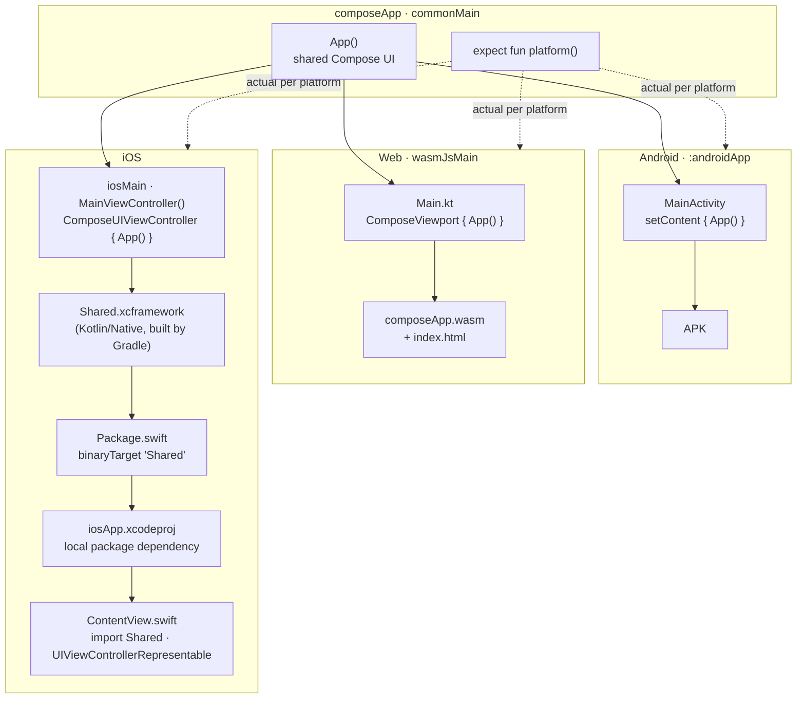
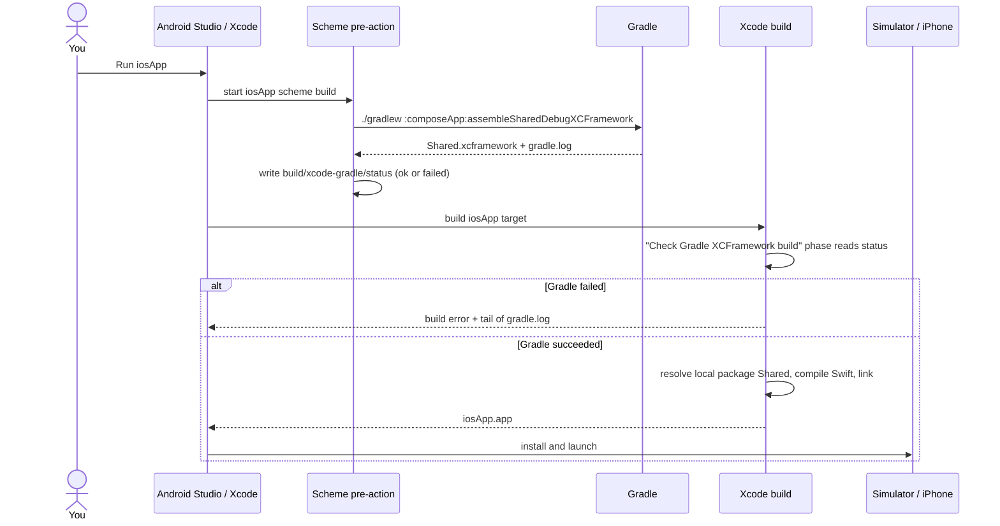
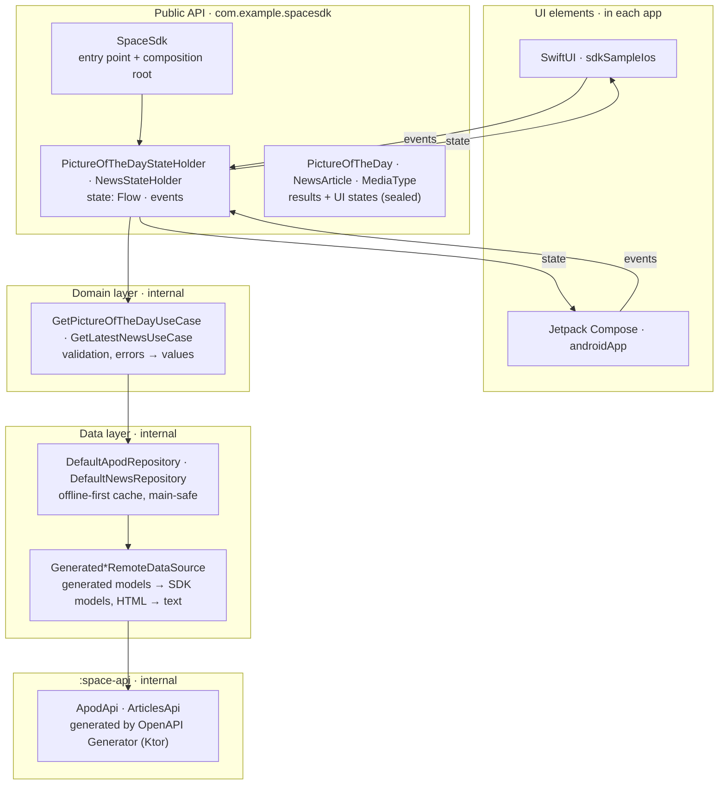

# kmp-spm

A small Kotlin Multiplatform + Compose Multiplatform demo that shares one Compose UI
across **Android**, **iOS**, and **Web (Wasm)**. On iOS, the shared Kotlin code is
delivered to Xcode as a **Swift Package Manager (SPM)** binary package, so the
project is named `kmp-spm`.

The app itself is a counter screen: it greets you with the current platform name
(for example `Hello from Android 35`, with the device's API level, or
`Hello from Web (Mozilla/5.0)`) and has a button that increments a count. The
point of the project is the build wiring, not the app.

This branch (`space-sdk`) adds **SpaceSdk**, an experimental, reusable SDK for
**Android and iOS** built from OpenAPI specs. It shows NASA's Astronomy Picture
of the Day and the latest spaceflight news. On iOS it ships as a prebuilt Swift
package made with Kotlin's Swift export. Its layers follow Android's app
architecture guide. See [SpaceSdk](#spacesdk). (The earlier iOS + Web version
of the SDK is on the `sdk-swift-export` branch.)

## Architecture

One Compose UI in `commonMain` is compiled for three platforms. Each platform
adds only a thin entry point. On iOS, the Kotlin output goes through a Swift
Package before the app sees it.



### What happens when you run the iOS app

Xcode never calls Kotlin directly. The scheme rebuilds the XCFramework first,
then the normal Xcode build links it through SPM:



## Project layout

```
.
├── composeApp/                       # Shared KMP module (Android library, iOS framework, Wasm app)
│   └── src/
│       ├── commonMain/               # Shared Compose UI (App.kt) + expect fun platform()
│       ├── androidMain/              # actual platform() for Android
│       ├── iosMain/                  # MainViewController() bridge + actual platform()
│       └── wasmJsMain/               # Browser entry point (Main.kt) + index.html
├── androidApp/                       # Android app: SpaceSdk sample screens (Compose)
├── space-api/                        # OpenAPI specs + generated Ktor clients (internal)
│   └── openapi/                      # apod.yaml (ours), spaceflight-news.json (published)
├── space-sdk/                        # SpaceSdk: public API, domain + data layers
├── sdkSampleIos/                     # SwiftUI sample using SpaceSdk's prebuilt Swift package
├── iosApp/
│   ├── iosApp/                       # SwiftUI shell that hosts the Compose view + Info.plist
│   └── iosApp.xcodeproj              # Xcode project with the iosApp scheme
├── Package.swift                     # Local SPM package wrapping the XCFramework
└── gradle/libs.versions.toml         # Every dependency and plugin version
```

- **Shared UI:** `App()` in `commonMain` is the whole UI. Each platform only
  provides an entry point and an `actual fun platform()`.
- **Android:** `composeApp` is an Android library
  (`com.android.kotlin.multiplatform.library`). The separate `:androidApp`
  module is the Android application. On this branch its `MainActivity` shows
  the SpaceSdk sample instead of the shared counter `App()`. This two-module
  layout is what AGP 9 requires for Kotlin Multiplatform projects.
- **Web:** the `wasmJs` target compiles `App()` to WebAssembly and serves it from
  `index.html`.
- **iOS through SPM:** the app links the Kotlin code as a prebuilt binary package:
  1. Gradle builds `composeApp/build/XCFrameworks/debug/Shared.xcframework`.
  2. The root `Package.swift` exposes that XCFramework as a binary target named `Shared`.
  3. `iosApp/iosApp.xcodeproj` depends on the repo root as a local package and
     does `import Shared`.
  4. `ContentView.swift` wraps the Kotlin `MainViewController()` in a
     `UIViewControllerRepresentable`, which is the `ComposeUIViewController { App() }`.

  The `iosApp` scheme has a pre-action that runs step 1 before every build, so
  Kotlin changes are picked up automatically. Xcode ignores pre-action failures,
  so the script records the result in `build/xcode-gradle/status`. The
  "Check Gradle XCFramework build" build phase then fails the build with the
  Gradle error if it failed. The full Gradle log is in `build/xcode-gradle/gradle.log`.

## Toolchain

| Component | Version |
| --- | --- |
| Gradle (wrapper) | 9.9.2 |
| Gradle daemon JDK | JetBrains JDK 21, auto-provisioned via the foojay resolver |
| Kotlin | 2.5.0-RC (preview, for Swift package export) |
| Android Gradle Plugin | 9.5.2 |
| Compose Multiplatform | 1.13.0-rc01 (Material3 1.13.0-rc01) |
| Android compileSdk / targetSdk / minSdk | 37.2 / 37 / 24 (Compose 1.13 needs 37.1+) |
| OpenAPI Generator | 7.27.0 (`kotlin` generator, `multiplatform` library) |
| Ktor / kotlinx.serialization | 3.6.1 / 1.13.0 |
| iOS targets | `iosArm64` (devices), `iosSimulatorArm64` (Apple Silicon simulators) |

All versions live in `gradle/libs.versions.toml`. You don't need a system-wide
Gradle or a specific JDK: the wrapper and the daemon toolchain settings
(`gradle/gradle-daemon-jvm.properties`) download what they need.

## Getting started

### Android

```sh
./gradlew :androidApp:installDebug
```

Or open the project in Android Studio and run the `androidApp` configuration.
On this branch the app is the SpaceSdk sample (needs internet).

### Web (Wasm)

**Development:** start a dev server with live reload:

```sh
./gradlew :composeApp:wasmJsBrowserDevelopmentRun
```

Then open http://localhost:8080 (the build prints the URL). In Android Studio,
use the `composeApp [wasmJs]` run configuration.

The build prints a long webpack summary. That's normal: it lists the bundled
files. The development build is unoptimized, so the files are large (about
19 MB for `composeApp.wasm`).

If a run reports failure right after a successful build, an earlier dev server
is probably still holding port 8080. Stop all `wasmJs` runs (or
`./gradlew --stop`) and start one fresh run. If the page looks stale, reload
with **⇧⌘R**.

**Production:** build an optimized bundle:

```sh
./gradlew :composeApp:wasmJsBrowserDistribution
```

The output goes to `composeApp/build/dist/wasmJs/productionExecutable/`:

| File | What it is | Size |
| --- | --- | --- |
| `index.html` | Page that loads the app | small |
| `composeApp.js` | Minified loader that starts the Wasm | ~0.5 MB |
| `<hash>.wasm` (from `composeApp.wasm`) | Your Kotlin code + Compose, optimized | ~2 MB |
| `<hash>.wasm` (from `skiko.wasm`) | Skia graphics engine used by Compose | ~8 MB |

The hashed file names change whenever the code changes, so browsers never use
a stale cached copy.

Webpack warns that these files exceed its "recommended size limit" (244 KB).
That limit is a rule of thumb for JavaScript and every Compose for Web app
exceeds it, so the warnings are safe to ignore.

**Deploying:** upload the whole `productionExecutable/` folder to any static
host (GitHub Pages, Netlify, Cloudflare Pages, S3, nginx, and so on). Two
requirements:

- Serve `.wasm` files with the `Content-Type: application/wasm` header.
  Browsers refuse to compile Wasm served with any other type.
- Turn on gzip or brotli compression. `.wasm` files compress very well, which
  cuts the download size substantially.

To check the production build locally before deploying, serve the folder with
any static server, for example:

```sh
python3 -m http.server 8000 -d composeApp/build/dist/wasmJs/productionExecutable
```

Then open http://localhost:8000. If the page stays blank, open the browser's
DevTools Network tab and check that the `.wasm` responses have type
`application/wasm`. The app also needs a browser with WebAssembly GC support:
current Chrome, Edge, Firefox, or Safari 18.2+.

### iOS

Requirements: a Mac with Xcode and its iOS platform component installed
(**Xcode ▸ Settings ▸ Components**, or `xcodebuild -downloadPlatform iOS`).

**First time only:** build the XCFramework once so Xcode can resolve the
`Shared` package when it opens the project:

```sh
./gradlew :composeApp:assembleSharedDebugXCFramework
```

After that, the scheme rebuilds it automatically.

**From Android Studio:** install the **Kotlin Multiplatform** plugin
(**Settings ▸ Plugins ▸ Marketplace**) and restart. Studio detects
`iosApp/iosApp.xcodeproj` and offers an `iosApp` run configuration. Pick a
simulator or a connected iPhone and click Run.

**From Xcode:** open `iosApp/iosApp.xcodeproj`, select the `iosApp` scheme and a
destination, and run.

**From the command line:**

```sh
xcodebuild -project iosApp/iosApp.xcodeproj -scheme iosApp \
  -destination 'platform=iOS Simulator,name=iPhone 17' build
```

To run on a physical iPhone, choose your Apple ID team under **Signing &
Capabilities** in Xcode first. The checked-in project has no team set.

For a release build, run `assembleSharedReleaseXCFramework` and change `debug`
to `release` in `Package.swift`. The scheme pre-action always builds debug.

## SpaceSdk

`:space-sdk` is a logic-only Kotlin Multiplatform SDK (no Compose) for native
apps. It wraps two public APIs, neither of which needs an API key:

- **NASA Astronomy Picture of the Day (APOD)**, from NASA Science's
  WordPress feed (`science.nasa.gov/wp-json/wp/v2/apod-basic`). NASA publishes
  no OpenAPI spec for it, so `space-api/openapi/apod.yaml` is written by hand
  from NASA's APOD feed guide and checked against live responses.
- **Spaceflight News API** v4, whose published spec is checked in as
  `space-api/openapi/spaceflight-news.json`.

How apps get it:

- **Android:** a regular Kotlin library (`implementation(project(":space-sdk"))`).
  Apps call `suspend` functions and collect `Flow` directly.
- **iOS:** a **prebuilt Swift package** produced by Kotlin's Swift export
  (Beta in Kotlin 2.5). Apps add it like any package and `import SpaceSdk`; no
  Gradle runs in the app's build. `suspend` → `async`, `Flow` →
  `AsyncSequence`, sealed classes → Swift enums.

### Layers

The structure follows Android's
[Guide to app architecture](https://developer.android.com/topic/architecture).
The SDK holds the data and domain layers plus shared UI state holders; each
app keeps only its native UI.



| Layer | Classes | Responsibility |
| --- | --- | --- |
| UI: state holders | `PictureOfTheDayStateHolder`, `NewsStateHolder` | Own screen state (`Loading` / `Success` / `NotFound` / `Error`) and receive events. The shared equivalent of a ViewModel. |
| Domain | `GetPictureOfTheDayUseCase`, `GetLatestNewsUseCase` | Validate input (dates, limits) and turn every outcome into a sealed result. |
| Data | `DefaultApodRepository`, `DefaultNewsRepository` | Cache results (single source of truth), fall back to cached data offline, run off the main thread. |
| Data sources | `GeneratedApodRemoteDataSource`, `GeneratedNewsRemoteDataSource` | Call the generated clients and map their models to SDK models (plain text, `String` dates). |
| Generated | `:space-api` (`ApodApi`, `ArticlesApi`, models) | Regenerated from the specs on every build into `space-api/build/generated/openapi/`. Never committed. |

Design rules:

- **Generated code stays internal.** `:space-sdk` depends on `:space-api` as
  `implementation`, so Swift export and Android apps never see generated or
  Ktor types. The exported Swift API contains only SDK types.
- **Expose as little as possible.** Only `com.example.spacesdk` is public;
  `explicitApi()` makes every public declaration deliberate.
- **Swift-friendly types.** Dates are ISO strings, `MediaType` is a plain enum,
  results are sealed, lists are `List<T>` (Swift arrays). No generics or date
  library types in the public API.
- **Errors are values.** HTTP errors keep a short message; network failures get
  a friendly sentence instead of a raw platform error.
- **Manual dependency injection.** `SpaceSdk` wires the graph through
  constructors; tests inject fakes through `internal` constructors.
- **Base URLs are set in code**, not taken from specs: the published
  Spaceflight News spec has no `servers` entry, so the generator would default
  to `http://localhost`.

### Using it from Swift

```swift
import SpaceSdk

let sdk = SpaceSdk()                                // one per app
let result = try await sdk.getPictureOfTheDay()     // suspend → async
switch result.sealedType() {                        // sealed → exhaustive enum
case .success(let s):  print(s.value.picture.title)
case .notFound(let n): print("no APOD for \(n.value.date)")
case .failure(let f):  print(f.value.message)
}

let news = sdk.createNews(limit: 20)                // state holder, starts loading
for try await state in news.state.asAsyncSequence() { /* render */ }
```

### Using it from Kotlin (Android)

```kotlin
val sdk = SpaceSdk()
when (val result = sdk.getPictureOfTheDay("2014-09-18")) {
    is PictureOfTheDayResult.Success -> show(result.picture)
    is PictureOfTheDayResult.NotFound -> showEmpty(result.date)
    is PictureOfTheDayResult.Failure -> showError(result.message)
}
// In a ViewModel: val picture = sdk.createPictureOfTheDay(); close() it in onCleared().
```

### Building and testing

```sh
./gradlew :space-api:iosSimulatorArm64Test    # generated clients vs recorded real responses
./gradlew :space-sdk:iosSimulatorArm64Test    # all SDK layers (27 tests)
./gradlew :space-sdk:exportDebugSwiftPackage  # -> space-sdk/SwiftPackage/Debug
./gradlew :androidApp:installDebug            # Android sample
```

Tests run offline: the generated clients are fed recorded real responses
through Ktor's `MockEngine`.

**iOS sample:** run `./gradlew :space-sdk:exportDebugSwiftPackage` once (and
after SDK changes), then open `sdkSampleIos/SdkSample.xcodeproj` and run the
`SdkSample` scheme. The project adds `space-sdk/SwiftPackage/Debug` as a local
package (product `SpaceSdkLibrary`). If Xcode shows stale SDK code, use
**File ▸ Packages ▸ Reset Package Caches**.

To update the Spaceflight News API, re-download its spec
(`https://api.spaceflightnewsapi.net/v4/schema/?format=json`) into
`space-api/openapi/` and rebuild; the compiler then points at any code that
needs changing.

### Limitations

- **Preview toolchain.** Kotlin 2.5.0-RC and Compose 1.13.0-rc01 are release
  candidates; Swift export is Beta and its Gradle DSL is marked experimental.
- **iOS 18 minimum** for the Swift package: Swift export's coroutine support
  uses Swift's `Mutex`.
- **Distribution by URL isn't documented yet.** The exported package works as
  a local package; shipping it to other teams (e.g. a release or a separate
  repo) is the next experiment.
- **Apple Silicon simulators only** (`x86_64` is excluded).
- **In-memory cache.** Data is cached for the app's lifetime; swap in
  SQLDelight or Room KMP for persistence across launches.
- **Generator bug** (OpenAPI Generator 7.27.0, `multiplatform`): an optional
  array request body generates code that doesn't compile. Our specs are
  read-only GETs, so they're not affected.
- **Simulator unit tests can't reach the network** on this machine (the apps
  can), which is one more reason the tests use recorded responses.

## Known limitations

- **Compose requires `CADisableMinimumFrameDurationOnPhone`.** Compose
  Multiplatform aborts at launch if the iOS app's `Info.plist` doesn't set this
  key to `true`. `iosApp/iosApp/Info.plist` sets it, so keep it if you
  regenerate the Xcode project.
- **No Intel-Mac iOS simulator.** Compose Multiplatform 1.12 no longer publishes
  `iosX64`, so the target was removed. Use an Apple Silicon Mac or a real device.
- **SPM caches binary targets aggressively.** If Xcode seems to run stale Kotlin
  code, use **File ▸ Packages ▸ Reset Package Caches**.
- **Framework size.** A debug Compose iOS framework is large (tens of MB). Release
  builds are much smaller.
- **Configuration cache is on.** If a plugin misbehaves, try
  `--no-configuration-cache`.
