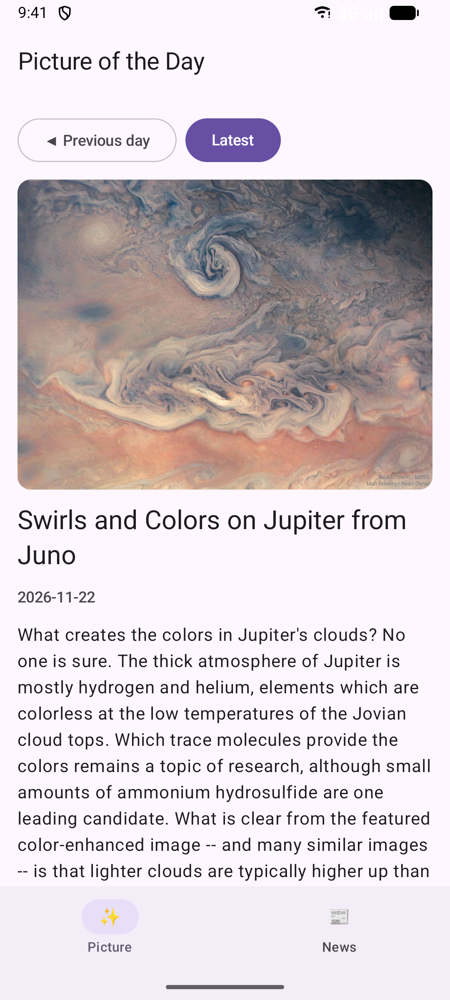
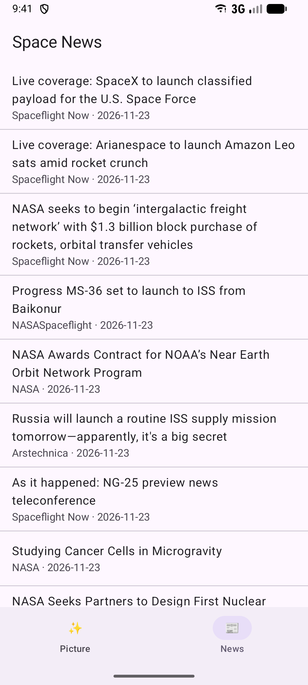
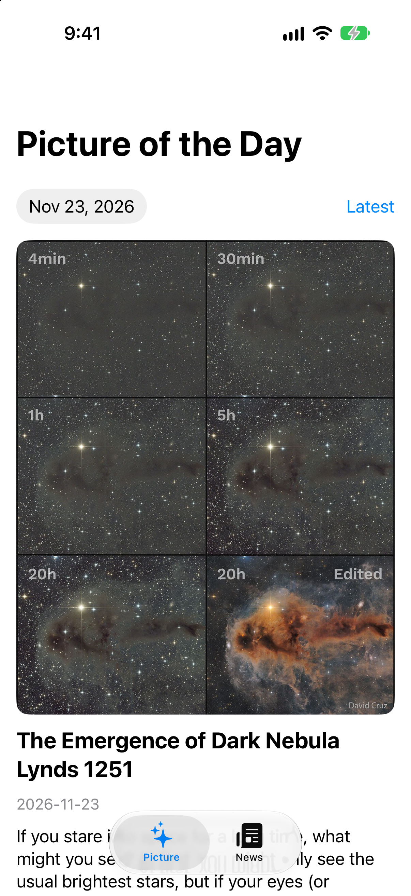
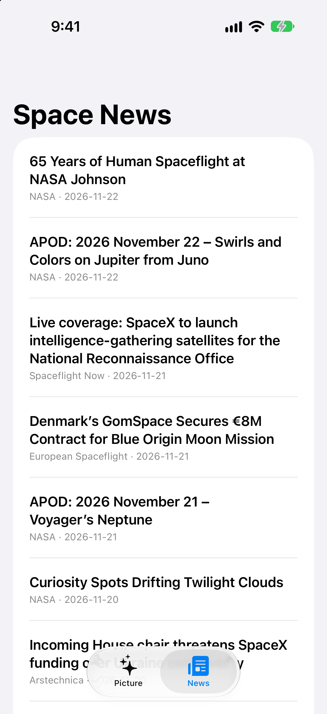
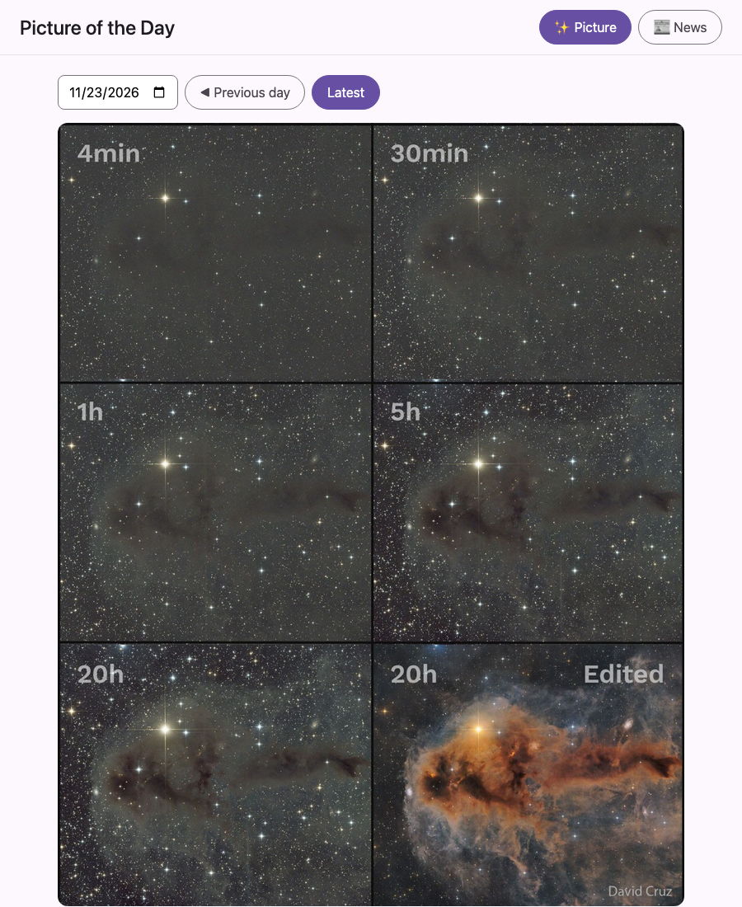
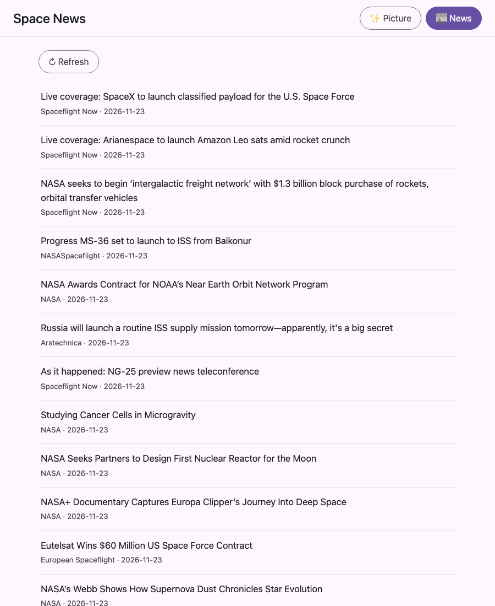
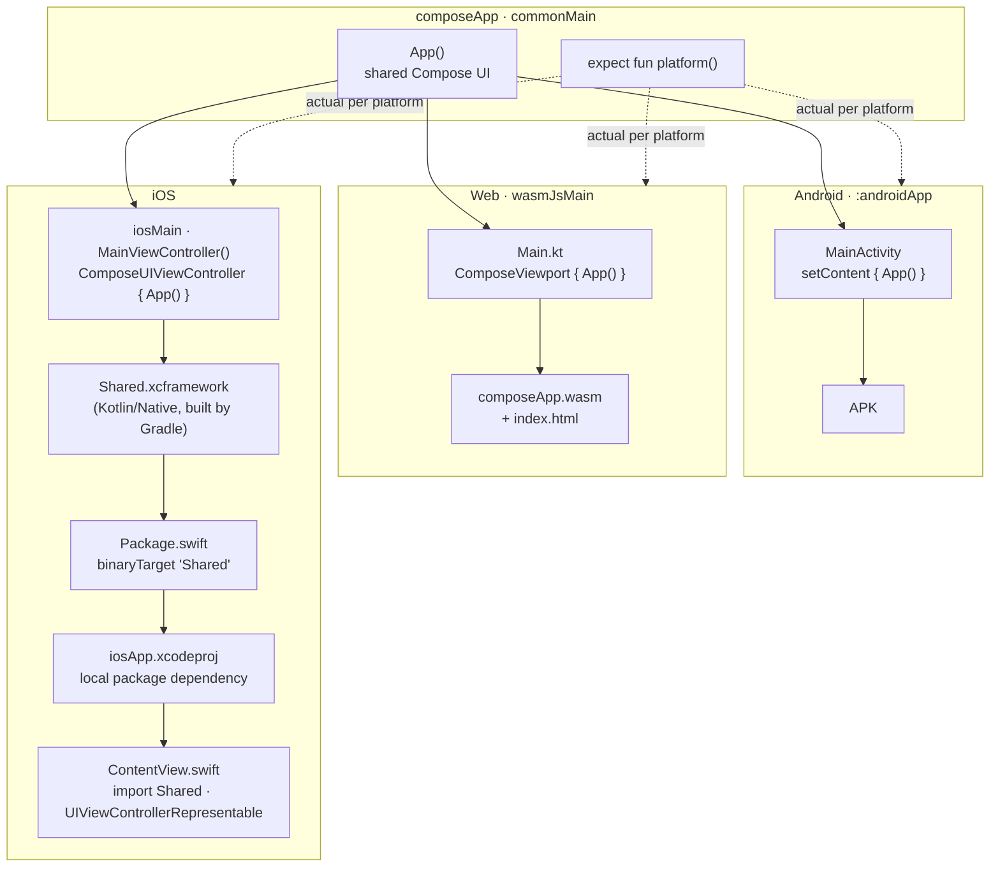
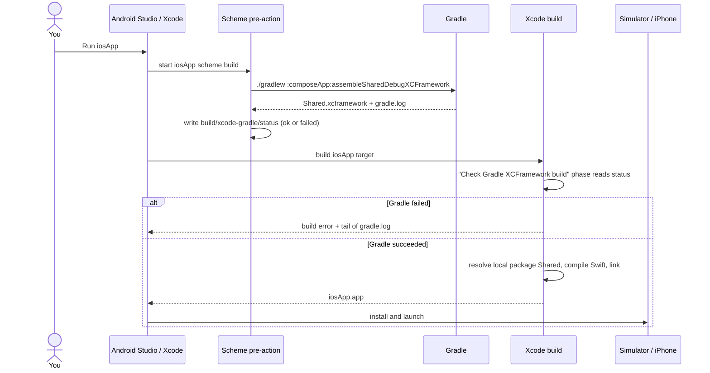
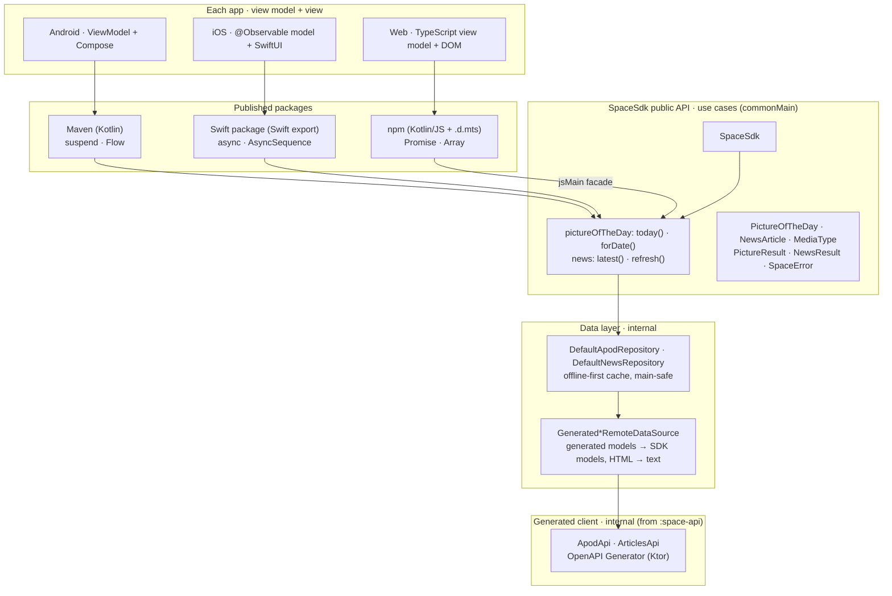

# kmp-spm · SpaceSdk

An experiment in building **one Kotlin Multiplatform SDK that native apps on
Android, iOS and the web can consume**, from OpenAPI specs to a published
package, with sample apps on top to demonstrate it.

## What this project does

**SpaceSdk** wraps two public APIs behind one small, native-feeling API:

- **NASA's Astronomy Picture of the Day (APOD):** today's picture, or any
  date back to 1995.
- **Spaceflight News:** the latest articles from space news sites.

The pipeline:

1. **OpenAPI specs** describe the APIs (`space-api/openapi/`). NASA publishes
   none for APOD, so that one is written by hand; Spaceflight News publishes
   its own.
2. **OpenAPI Generator** turns the specs into a Kotlin Multiplatform HTTP
   client (Ktor), regenerated on every build.
3. **SpaceSdk** (`space-sdk/`) wraps the generated client in a small API made
   of **use cases**: get today's picture, get a picture for a date, get the
   latest news. Caching, validation, mapping and the generated code are all
   internal; it publishes as a single package.
4. **Each platform consumes it natively:**
   - **Android:** a regular Kotlin library.
   - **iOS:** a prebuilt Swift package (Kotlin's Swift export), so Swift code
     gets `async` functions, `AsyncSequence` streams and exhaustive enums.
   - **Web:** an npm package (Kotlin/JS, ES modules) with TypeScript
     definitions, so TypeScript code gets Promises, arrays and typed results.
5. **Separate sample apps** (`samples/`) consume the *published* packages, like
   any outside app, and put a thin UI on top to demonstrate the SDK.

### Two ways to use the SDK

Each platform gets its own small app, in its own build, that knows SpaceSdk
only as a published package:

| App | Location | Gets SpaceSdk from | Screen structure |
| --- | --- | --- | --- |
| **Android** | `samples/android/` (standalone Gradle build) | GitHub Packages: `io.github.bdiesel.spacesdk:space-sdk:0.2.0` | `ViewModel` + Compose screen |
| **iOS** | `samples/ios/` (standalone Xcode project) | Swift package `https://github.com/bdiesel/SpaceSdk-swift` 0.2.0 | `@Observable` model + SwiftUI view |
| **Web** | `samples/web/` (Vite + plain TypeScript, no framework) | GitHub Packages npm: `@bdiesel/space-sdk@0.2.0` | view model class + DOM view |

Each screen has a **thin view model** that calls the SDK's use cases and a
**view** that renders it. The SDK holds no screen state; each app owns its UX.
Neither app can see the SDK's source, so they show exactly what an outside
developer gets.

### Screenshots

The same SDK, rendered by each platform's own UI toolkit:

| | Picture of the Day | Space News |
| --- | --- | --- |
| **Android** (Jetpack Compose) |  |  |
| **iOS** (SwiftUI) |  |  |
| **Web** (TypeScript + DOM) |  |  |

See [SpaceSdk](#spacesdk) for the API, layers and build steps.

### Where this started

The repo began as a Compose Multiplatform demo: one shared counter screen on
**Android**, **iOS** and **Web (Wasm)**, with the iOS framework delivered to
Xcode through a **Swift Package Manager (SPM)** binary package (hence
`kmp-spm`). That app (`composeApp`, `iosApp`) and its build wiring are still
here and documented below. The earlier iOS + Web version of the SDK is on the
`sdk-swift-export` branch.

## Original demo app: architecture

One Compose UI in `commonMain` is compiled for three platforms. Each platform
adds only a thin entry point. On iOS, the Kotlin output goes through a Swift
Package before the app sees it.



### What happens when you run the iOS app

Xcode never calls Kotlin directly. The scheme rebuilds the XCFramework first,
then the normal Xcode build links it through SPM:



## Project layout

```
.
├── composeApp/                       # Shared KMP module (Android library, iOS framework, Wasm app)
│   └── src/
│       ├── commonMain/               # Shared Compose UI (App.kt) + expect fun platform()
│       ├── androidMain/              # actual platform() for Android
│       ├── iosMain/                  # MainViewController() bridge + actual platform()
│       └── wasmJsMain/               # Browser entry point (Main.kt) + index.html
├── androidApp/                       # Android app hosting the shared counter UI
├── space-api/                        # OpenAPI specs + generated Ktor clients (internal)
│   └── openapi/                      # apod.yaml (ours), spaceflight-news.json (published)
├── space-sdk/                        # SpaceSdk: use cases + internal data layer
├── samples/                          # Standalone apps that consume the published SDK
│   ├── android/                      #   own Gradle build: ViewModels + Compose
│   ├── ios/                          #   own Xcode project: @Observable models + SwiftUI
│   └── web/                          #   own npm project: TypeScript view models + DOM views
├── iosApp/
│   ├── iosApp/                       # SwiftUI shell that hosts the Compose view + Info.plist
│   └── iosApp.xcodeproj              # Xcode project with the iosApp scheme
├── Package.swift                     # Local SPM package wrapping the XCFramework
└── gradle/libs.versions.toml         # Every dependency and plugin version
```

- **Shared UI:** `App()` in `commonMain` is the whole UI. Each platform only
  provides an entry point and an `actual fun platform()`.
- **Android:** `composeApp` is an Android library
  (`com.android.kotlin.multiplatform.library`). The separate `:androidApp`
  module is the Android application: it depends on `:composeApp`, and its
  `MainActivity` calls `setContent { App() }`. This two-module layout is what
  AGP 9 requires for Kotlin Multiplatform projects.
- **Web:** the `wasmJs` target compiles `App()` to WebAssembly and serves it from
  `index.html`.
- **iOS through SPM:** the app links the Kotlin code as a prebuilt binary package:
  1. Gradle builds `composeApp/build/XCFrameworks/debug/Shared.xcframework`.
  2. The root `Package.swift` exposes that XCFramework as a binary target named `Shared`.
  3. `iosApp/iosApp.xcodeproj` depends on the repo root as a local package and
     does `import Shared`.
  4. `ContentView.swift` wraps the Kotlin `MainViewController()` in a
     `UIViewControllerRepresentable`, which is the `ComposeUIViewController { App() }`.

  The `iosApp` scheme has a pre-action that runs step 1 before every build, so
  Kotlin changes are picked up automatically. Xcode ignores pre-action failures,
  so the script records the result in `build/xcode-gradle/status`. The
  "Check Gradle XCFramework build" build phase then fails the build with the
  Gradle error if it failed. The full Gradle log is in `build/xcode-gradle/gradle.log`.

## Toolchain

| Component | Version |
| --- | --- |
| Gradle (wrapper) | 9.9.2 |
| Gradle daemon JDK | JetBrains JDK 21, auto-provisioned via the foojay resolver |
| Kotlin | 2.5.0-RC (preview, for Swift package export) |
| Android Gradle Plugin | 9.5.2 |
| Compose Multiplatform | 1.13.0-rc01 (Material3 1.13.0-rc01) |
| Android compileSdk / targetSdk / minSdk | 37.2 / 37 / 24 (Compose 1.13 needs 37.1+) |
| OpenAPI Generator | 7.27.0 (`kotlin` generator, `multiplatform` library) |
| Ktor / kotlinx.serialization | 3.6.1 / 1.13.0 |
| iOS targets | `iosArm64` (devices), `iosSimulatorArm64` (Apple Silicon simulators) |

All versions live in `gradle/libs.versions.toml`. You don't need a system-wide
Gradle or a specific JDK: the wrapper and the daemon toolchain settings
(`gradle/gradle-daemon-jvm.properties`) download what they need.

## Getting started

### Android

```sh
./gradlew :androidApp:installDebug
```

Or open the project in Android Studio and run the `androidApp` configuration.
(The SpaceSdk samples live in `samples/`; see [SpaceSdk](#spacesdk).)

### Web (Wasm)

**Development:** start a dev server with live reload:

```sh
./gradlew :composeApp:wasmJsBrowserDevelopmentRun
```

Then open http://localhost:8080 (the build prints the URL). In Android Studio,
use the `composeApp [wasmJs]` run configuration.

The build prints a long webpack summary. That's normal: it lists the bundled
files. The development build is unoptimized, so the files are large (about
19 MB for `composeApp.wasm`).

If a run reports failure right after a successful build, an earlier dev server
is probably still holding port 8080. Stop all `wasmJs` runs (or
`./gradlew --stop`) and start one fresh run. If the page looks stale, reload
with **⇧⌘R**.

**Production:** build an optimized bundle:

```sh
./gradlew :composeApp:wasmJsBrowserDistribution
```

The output goes to `composeApp/build/dist/wasmJs/productionExecutable/`:

| File | What it is | Size |
| --- | --- | --- |
| `index.html` | Page that loads the app | small |
| `composeApp.js` | Minified loader that starts the Wasm | ~0.5 MB |
| `<hash>.wasm` (from `composeApp.wasm`) | Your Kotlin code + Compose, optimized | ~2 MB |
| `<hash>.wasm` (from `skiko.wasm`) | Skia graphics engine used by Compose | ~8 MB |

The hashed file names change whenever the code changes, so browsers never use
a stale cached copy.

Webpack warns that these files exceed its "recommended size limit" (244 KB).
That limit is a rule of thumb for JavaScript and every Compose for Web app
exceeds it, so the warnings are safe to ignore.

**Deploying:** upload the whole `productionExecutable/` folder to any static
host (GitHub Pages, Netlify, Cloudflare Pages, S3, nginx, and so on). Two
requirements:

- Serve `.wasm` files with the `Content-Type: application/wasm` header.
  Browsers refuse to compile Wasm served with any other type.
- Turn on gzip or brotli compression. `.wasm` files compress very well, which
  cuts the download size substantially.

To check the production build locally before deploying, serve the folder with
any static server, for example:

```sh
python3 -m http.server 8000 -d composeApp/build/dist/wasmJs/productionExecutable
```

Then open http://localhost:8000. If the page stays blank, open the browser's
DevTools Network tab and check that the `.wasm` responses have type
`application/wasm`. The app also needs a browser with WebAssembly GC support:
current Chrome, Edge, Firefox, or Safari 18.2+.

### iOS

Requirements: a Mac with Xcode and its iOS platform component installed
(**Xcode ▸ Settings ▸ Components**, or `xcodebuild -downloadPlatform iOS`).

**First time only:** build the XCFramework once so Xcode can resolve the
`Shared` package when it opens the project:

```sh
./gradlew :composeApp:assembleSharedDebugXCFramework
```

After that, the scheme rebuilds it automatically.

**From Android Studio:** install the **Kotlin Multiplatform** plugin
(**Settings ▸ Plugins ▸ Marketplace**) and restart. Studio detects
`iosApp/iosApp.xcodeproj` and offers an `iosApp` run configuration. Pick a
simulator or a connected iPhone and click Run.

**From Xcode:** open `iosApp/iosApp.xcodeproj`, select the `iosApp` scheme and a
destination, and run.

**From the command line:**

```sh
xcodebuild -project iosApp/iosApp.xcodeproj -scheme iosApp \
  -destination 'platform=iOS Simulator,name=iPhone 17' build
```

To run on a physical iPhone, choose your Apple ID team under **Signing &
Capabilities** in Xcode first. The checked-in project has no team set.

For a release build, run `assembleSharedReleaseXCFramework` and change `debug`
to `release` in `Package.swift`. The scheme pre-action always builds debug.

## SpaceSdk

`:space-sdk` is a logic-only Kotlin Multiplatform SDK (no Compose) for native
apps. It wraps two public APIs, neither of which needs an API key:

- **NASA Astronomy Picture of the Day (APOD)**, from NASA Science's
  WordPress feed (`science.nasa.gov/wp-json/wp/v2/apod-basic`). NASA publishes
  no OpenAPI spec for it, so `space-api/openapi/apod.yaml` is written by hand
  from NASA's APOD feed guide and checked against live responses.
- **Spaceflight News API** v4, whose published spec is checked in as
  `space-api/openapi/spaceflight-news.json`.

How apps get it:

- **Android:** a regular Kotlin library from Maven
  (`io.github.bdiesel.spacesdk:space-sdk`). Apps call `suspend` functions and
  collect `Flow` directly.
- **iOS:** a **prebuilt Swift package** produced by Kotlin's Swift export
  (Beta in Kotlin 2.5). Apps add it like any package and `import SpaceSdk`; no
  Gradle runs in the app's build. `suspend` → `async`, `Flow` →
  `AsyncSequence`, sealed classes → Swift enums.
- **Web:** an **npm package** compiled by Kotlin/JS (ES modules, with
  generated `.d.mts` TypeScript definitions). A small JS-only facade
  (`space-sdk/src/jsMain`) turns `suspend` functions into Promises and lists
  into arrays; the use cases behind it are the same shared code. This is
  Kotlin/JS, not Wasm: Kotlin/Wasm can only export primitive types to
  JavaScript, so classes like `SpaceSdk` and the result types couldn't be
  used from TypeScript. (Wasm is still used by the original Compose demo.)

### Public API: use cases

Everything a consumer sees:

| | |
| --- | --- |
| `SpaceSdk()` | Entry point. Create one per app and share it; no API key needed. |
| `sdk.pictureOfTheDay.today()` | The most recent Astronomy Picture of the Day. |
| `sdk.pictureOfTheDay.forDate(year, month, day)` | The picture for a date (1995-06-16 or later). |
| `sdk.news.latest(count)` | The latest spaceflight news (cached when available). |
| `sdk.news.refresh(count)` | The latest news, always fetched fresh. |
| `PictureOfTheDay`, `NewsArticle`, `MediaType` | Models (plain text, ISO dates). |
| `PictureResult`, `NewsResult` | `Success` or `Failure(error)`; functions never throw. |
| `SpaceError` | `NETWORK`, `SERVER`, `NOT_FOUND`, `INVALID_DATE`. Apps choose the wording. |

### Layers

Behind the use cases the structure follows Android's
[Guide to app architecture](https://developer.android.com/topic/architecture).
Screen state is deliberately **not** in the SDK: each app's view models own it.



| Layer | Classes | Responsibility |
| --- | --- | --- |
| App: view model + view | per screen, per platform | Owns screen state and UX (loading, retry, wording of errors). Not part of the SDK. |
| Use cases (public) | `PictureOfTheDayUseCases`, `NewsUseCases` | Validate input (dates, counts) and turn every outcome into a sealed result with a typed `SpaceError`. |
| Data | `DefaultApodRepository`, `DefaultNewsRepository` | Cache results (single source of truth), fall back to cached data offline, run off the main thread. |
| Data sources | `GeneratedApodRemoteDataSource`, `GeneratedNewsRemoteDataSource` | Call the generated clients and map their models to SDK models (plain text, `String` dates). |
| Generated | `ApodApi`, `ArticlesApi`, models | Generated by `:space-api` from the specs on every build, compiled **into** `:space-sdk` as `internal` code. Never committed. |

Design rules:

- **Use cases are the API.** Consumers never see repositories, generated
  code, Ktor or screen state; they call a use case and get a result.
- **Two modules, one package.** `:space-api` owns the specs and the generator
  (and tests the generated clients); `:space-sdk` compiles those generated
  sources as `internal` code. There's one Android artifact
  (`io.github.bdiesel.spacesdk:space-sdk`) and one Swift package.
- **Expose as little as possible.** Only `com.example.spacesdk` is public;
  `explicitApi()` makes every public declaration deliberate.
- **Swift-friendly types.** Dates go in as year/month/day and come out as ISO
  strings, `MediaType` and `SpaceError` are plain enums, results are sealed,
  lists are `List<T>` (Swift arrays). No generics or date library types.
- **Errors are values.** A typed `SpaceError`, never a raw platform error;
  each app decides how to word it.
- **Manual dependency injection.** `SpaceSdk` wires the graph through
  constructors; tests inject fakes through `internal` constructors.
- **Base URLs are set in code**, not taken from specs: the published
  Spaceflight News spec has no `servers` entry, so the generator would default
  to `http://localhost`.

### Using it from Swift

```swift
import SpaceSdk

let sdk = SpaceSdk()                                          // one per app
let result = try await sdk.pictureOfTheDay.forDate(year: 2014, month: 9, day: 18)
switch result.sealedType() {                                  // sealed → exhaustive enum
case .success(let s): print(s.value.picture.title)
case .failure(let f): print(f.value.error)                    // .NETWORK, .NOT_FOUND, …
}

let news = try await sdk.news.latest(count: 20)
```

In the sample, each screen's `@Observable` model calls these and the SwiftUI
view renders the model (`PictureOfTheDayModel`, `NewsModel`).

### Using it from Kotlin (Android)

```kotlin
val sdk = SpaceSdk()
when (val result = sdk.pictureOfTheDay.today()) {
    is PictureResult.Success -> show(result.picture)
    is PictureResult.Failure -> showError(result.error) // SpaceError
}
val news = sdk.news.latest(count = 20)
```

In the sample, each screen's `ViewModel` calls these from `viewModelScope` and
exposes its own `StateFlow` to a Compose screen (`PictureOfTheDayViewModel`,
`NewsViewModel`).

### Using it from TypeScript (web)

```ts
import { SpaceSdk, PictureResult, NewsResult } from "@bdiesel/space-sdk";

const sdk = new SpaceSdk();                                   // one per app
const result = await sdk.pictureOfTheDay.forDate(2014, 9, 18); // never rejects
if (result instanceof PictureResult.Success) {
  console.log(result.picture.title);
} else if (result instanceof PictureResult.Failure) {
  console.log(result.error.name);                             // "NETWORK", "NOT_FOUND", …
}

const news = await sdk.news.latest(20);
if (news instanceof NewsResult.Success) news.articles.map((a) => a.title); // a real Array
```

Both APIs allow cross-origin requests, so the SDK works straight from the
browser with no proxy. In the sample, each screen has a view model class with a
tiny observable store and a view that renders it with DOM APIs
(`pictureOfTheDayViewModel.ts`, `newsViewModel.ts`).

### Building and testing

```sh
./gradlew :space-api:iosSimulatorArm64Test    # generated clients vs recorded real responses
./gradlew :space-sdk:iosSimulatorArm64Test    # use cases, repositories, mapping (23 tests)
./gradlew :space-sdk:exportDebugSwiftPackage  # -> space-sdk/SwiftPackage/Debug
./gradlew :space-sdk:allTests                 # also runs the tests in Node and a headless browser
./gradlew :space-sdk:jsBrowserProductionLibraryDistribution  # npm package contents
```

Tests run offline: the generated clients are fed recorded real responses
through Ktor's `MockEngine`.

### Running the sample apps

The samples are separate projects that use the **published** SDK, so they
build without this repo's Gradle build.

**Android** (`samples/android`): GitHub Packages needs a token with
`read:packages`, even for public packages. Put it in
`~/.gradle/gradle.properties` (`gpr.user=<github user>`, `gpr.key=<token>`) or
the environment, then:

```sh
cd samples/android
GITHUB_ACTOR=<github user> GITHUB_TOKEN=$(gh auth token) ./gradlew :app:installDebug
```

Or open `samples/android` in Android Studio as its own project. It uses stable
tooling (Kotlin 2.4.21, Compose BOM 2026.11.01).

**iOS** (`samples/ios`): open `samples/ios/SdkSample.xcodeproj` and run the
`SdkSample` scheme. Xcode downloads `SpaceSdk-swift` 0.2.0 from GitHub; no
token needed. To try unreleased SDK changes, run
`./gradlew :space-sdk:exportDebugSwiftPackage` and point the package
dependency at the local folder `space-sdk/SwiftPackage/Debug`.

**Web** (`samples/web`): GitHub Packages needs a token for npm too.
`samples/web/.npmrc` points the `@bdiesel` scope at GitHub Packages and reads
the token from `NODE_AUTH_TOKEN`, so no token is stored in the repo:

```sh
cd samples/web
NODE_AUTH_TOKEN=$(gh auth token) npm install
npm run dev        # http://localhost:5173
npm run build      # type-check + production bundle in dist/
```

## Installing SpaceSdk

### iOS (Swift Package Manager)

In Xcode: **File ▸ Add Package Dependencies…** →
`https://github.com/bdiesel/SpaceSdk-swift` → version `0.2.0` → product
**SpaceSdkLibrary**. Or in a `Package.swift`:

```swift
.package(url: "https://github.com/bdiesel/SpaceSdk-swift", from: "0.2.0")
// target dependency: .product(name: "SpaceSdkLibrary", package: "SpaceSdk-swift")
```

The repo holds `Package.swift` and the generated Swift sources; the compiled
Kotlin (`SpaceSdkKotlin.xcframework`) is a zip on the GitHub release, verified
by checksum. No token is needed. Requires iOS 18.

### Android (Maven)

```kotlin
// settings.gradle.kts
repositories {
    maven("https://maven.pkg.github.com/bdiesel/kmp-spm") {
        credentials {
            username = "<github user>"
            password = "<token with read:packages>" // keep it in ~/.gradle/gradle.properties
        }
    }
}
// build.gradle.kts
implementation("io.github.bdiesel.spacesdk:space-sdk:0.2.0")
```

GitHub Packages requires a token even to download public packages.

### Web (npm)

```sh
# .npmrc in your project (the token comes from the environment)
@bdiesel:registry=https://npm.pkg.github.com
//npm.pkg.github.com/:_authToken=${NODE_AUTH_TOKEN}
```

```sh
NODE_AUTH_TOKEN=<token with read:packages> npm install @bdiesel/space-sdk@0.2.0
```

The package is ES modules only and includes TypeScript definitions. It runs in
browsers and in Node 18+.

## Publishing a release

The version lives in `gradle.properties` (`spacesdk.version`).

**iOS:**

```sh
scripts/release-swift-package.sh            # -> build/swift-release/<version>/
```

The script exports the release Swift package, zips the XCFramework, and
rewrites `Package.swift` to download it from
`github.com/bdiesel/SpaceSdk-swift/releases/download/<version>/` with its
checksum. Then copy `package/` into the `SpaceSdk-swift` repo, commit, tag
`<version>`, and create a GitHub release with the zip attached
(`gh release create <version> SpaceSdkKotlin.xcframework.zip`). The zip and
the checksum must come from the same script run.

**Android:**

```sh
# needs a token with write:packages: gh auth refresh -s write:packages,read:packages
GITHUB_ACTOR=bdiesel GITHUB_TOKEN=$(gh auth token) \
  ./gradlew :space-sdk:publishAllPublicationsToGitHubPackagesRepository
# one artifact: the generated client is compiled into space-sdk
```

Use `publishToMavenLocal` instead to test the artifacts locally.

**Web:**

```sh
scripts/release-npm-package.sh              # -> build/npm-release/<version>/
cd build/npm-release/<version>
NODE_AUTH_TOKEN=$(gh auth token) npm publish   # needs write:packages
```

The script builds the production Kotlin/JS library, names it
`@bdiesel/space-sdk`, sets the version and the GitHub Packages registry, and
adds a README. Run `npm pack --dry-run` in the folder to see exactly what will
be published.

To update the Spaceflight News API, re-download its spec
(`https://api.spaceflightnewsapi.net/v4/schema/?format=json`) into
`space-api/openapi/` and rebuild; the compiler then points at any code that
needs changing.

### Limitations

- **Preview toolchain.** Kotlin 2.5.0-RC and Compose 1.13.0-rc01 are release
  candidates; Swift export is Beta and its Gradle DSL is marked experimental.
- **iOS 18 minimum** for the Swift package: Swift export's coroutine support
  uses Swift's `Mutex`.
- **Swift package distribution is our own setup.** JetBrains documents the
  exported package as a local package; serving it from a separate repo with a
  release zip (see [Publishing a release](#publishing-a-release)) works but
  isn't an official workflow yet.
- **Apple Silicon simulators only** (`x86_64` is excluded).
- **In-memory cache.** Data is cached for the app's lifetime; swap in
  SQLDelight or Room KMP for persistence across launches.
- **Generator bug** (OpenAPI Generator 7.27.0, `multiplatform`): an optional
  array request body generates code that doesn't compile. Our specs are
  read-only GETs, so they're not affected.
- **Simulator unit tests can't reach the network** on this machine (the apps
  can), which is one more reason the tests use recorded responses.

## Known limitations

- **Compose requires `CADisableMinimumFrameDurationOnPhone`.** Compose
  Multiplatform aborts at launch if the iOS app's `Info.plist` doesn't set this
  key to `true`. `iosApp/iosApp/Info.plist` sets it, so keep it if you
  regenerate the Xcode project.
- **No Intel-Mac iOS simulator.** Compose Multiplatform 1.12 no longer publishes
  `iosX64`, so the target was removed. Use an Apple Silicon Mac or a real device.
- **SPM caches binary targets aggressively.** If Xcode seems to run stale Kotlin
  code, use **File ▸ Packages ▸ Reset Package Caches**.
- **Framework size.** A debug Compose iOS framework is large (tens of MB). Release
  builds are much smaller.
- **Configuration cache is on.** If a plugin misbehaves, try
  `--no-configuration-cache`.
