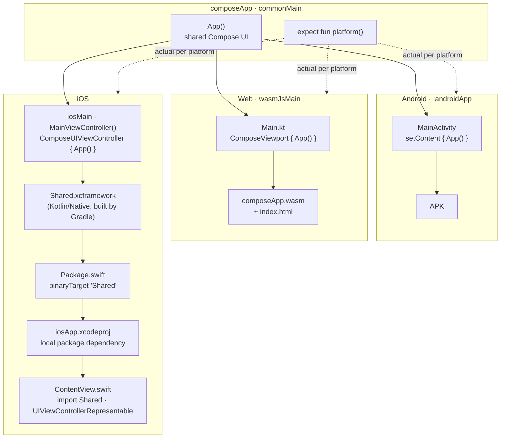
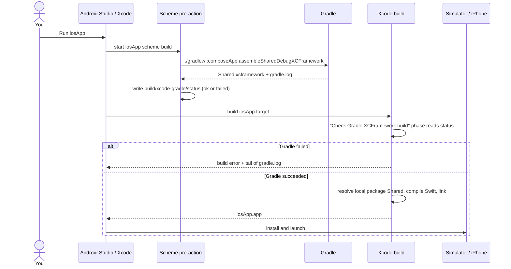

# kmp-spm

A small Kotlin Multiplatform + Compose Multiplatform demo that shares one Compose UI
across **Android**, **iOS**, and **Web (Wasm)**. On iOS, the shared Kotlin code is
delivered to Xcode as a **Swift Package Manager (SPM)** binary package, so the
project is named `kmp-spm`.

The app itself is a counter screen: it greets you with the current platform name
(for example `Hello from Android 35`, with the device's API level, or
`Hello from Web (Mozilla/5.0)`) and has a button that increments a count. The
point of the project is the build wiring, not the app.

## Architecture

One Compose UI in `commonMain` is compiled for three platforms. Each platform
adds only a thin entry point. On iOS, the Kotlin output goes through a Swift
Package before the app sees it.



### What happens when you run the iOS app

Xcode never calls Kotlin directly. The scheme rebuilds the XCFramework first,
then the normal Xcode build links it through SPM:



## Project layout

```
.
├── composeApp/                       # Shared KMP module (Android library, iOS framework, Wasm app)
│   └── src/
│       ├── commonMain/               # Shared Compose UI (App.kt) + expect fun platform()
│       ├── androidMain/              # actual platform() for Android
│       ├── iosMain/                  # MainViewController() bridge + actual platform()
│       └── wasmJsMain/               # Browser entry point (Main.kt) + index.html
├── androidApp/                       # Android application: MainActivity + AndroidManifest
├── iosApp/
│   ├── iosApp/                       # SwiftUI shell that hosts the Compose view + Info.plist
│   └── iosApp.xcodeproj              # Xcode project with the iosApp scheme
├── Package.swift                     # Local SPM package wrapping the XCFramework
└── gradle/libs.versions.toml         # Every dependency and plugin version
```

- **Shared UI:** `App()` in `commonMain` is the whole UI. Each platform only
  provides an entry point and an `actual fun platform()`.
- **Android:** `composeApp` is an Android library
  (`com.android.kotlin.multiplatform.library`). The separate `:androidApp`
  module is the Android application: it depends on `:composeApp`, and its
  `MainActivity` calls `setContent { App() }`. This two-module layout is what
  AGP 9 requires for Kotlin Multiplatform projects.
- **Web:** the `wasmJs` target compiles `App()` to WebAssembly and serves it from
  `index.html`.
- **iOS through SPM:** the app links the Kotlin code as a prebuilt binary package:
  1. Gradle builds `composeApp/build/XCFrameworks/debug/Shared.xcframework`.
  2. The root `Package.swift` exposes that XCFramework as a binary target named `Shared`.
  3. `iosApp/iosApp.xcodeproj` depends on the repo root as a local package and
     does `import Shared`.
  4. `ContentView.swift` wraps the Kotlin `MainViewController()` in a
     `UIViewControllerRepresentable`, which is the `ComposeUIViewController { App() }`.

  The `iosApp` scheme has a pre-action that runs step 1 before every build, so
  Kotlin changes are picked up automatically. Xcode ignores pre-action failures,
  so the script records the result in `build/xcode-gradle/status`. The
  "Check Gradle XCFramework build" build phase then fails the build with the
  Gradle error if it failed. The full Gradle log is in `build/xcode-gradle/gradle.log`.

## Toolchain

| Component | Version |
| --- | --- |
| Gradle (wrapper) | 9.9.2 |
| Gradle daemon JDK | JetBrains JDK 21, auto-provisioned via the foojay resolver |
| Kotlin | 2.4.21 |
| Android Gradle Plugin | 9.5.2 |
| Compose Multiplatform | 1.12.2 (Material3 1.9.0) |
| Android compileSdk / targetSdk / minSdk | 37 / 37 / 24 |
| iOS targets | `iosArm64` (devices), `iosSimulatorArm64` (Apple Silicon simulators) |

All versions live in `gradle/libs.versions.toml`. You don't need a system-wide
Gradle or a specific JDK: the wrapper and the daemon toolchain settings
(`gradle/gradle-daemon-jvm.properties`) download what they need.

## Getting started

### Android

```sh
./gradlew :androidApp:installDebug
```

Or open the project in Android Studio and run the `androidApp` configuration.

### Web (Wasm)

```sh
./gradlew :composeApp:wasmJsBrowserDevelopmentRun
```

Then open the URL it prints.

### iOS

Requirements: a Mac with Xcode and its iOS platform component installed
(**Xcode ▸ Settings ▸ Components**, or `xcodebuild -downloadPlatform iOS`).

**First time only:** build the XCFramework once so Xcode can resolve the
`Shared` package when it opens the project:

```sh
./gradlew :composeApp:assembleSharedDebugXCFramework
```

After that, the scheme rebuilds it automatically.

**From Android Studio:** install the **Kotlin Multiplatform** plugin
(**Settings ▸ Plugins ▸ Marketplace**) and restart. Studio detects
`iosApp/iosApp.xcodeproj` and offers an `iosApp` run configuration. Pick a
simulator or a connected iPhone and click Run.

**From Xcode:** open `iosApp/iosApp.xcodeproj`, select the `iosApp` scheme and a
destination, and run.

**From the command line:**

```sh
xcodebuild -project iosApp/iosApp.xcodeproj -scheme iosApp \
  -destination 'platform=iOS Simulator,name=iPhone 17' build
```

To run on a physical iPhone, choose your Apple ID team under **Signing &
Capabilities** in Xcode first. The checked-in project has no team set.

For a release build, run `assembleSharedReleaseXCFramework` and change `debug`
to `release` in `Package.swift`. The scheme pre-action always builds debug.

## Known limitations

- **Compose requires `CADisableMinimumFrameDurationOnPhone`.** Compose
  Multiplatform aborts at launch if the iOS app's `Info.plist` doesn't set this
  key to `true`. `iosApp/iosApp/Info.plist` sets it, so keep it if you
  regenerate the Xcode project.
- **No Intel-Mac iOS simulator.** Compose Multiplatform 1.12 no longer publishes
  `iosX64`, so the target was removed. Use an Apple Silicon Mac or a real device.
- **Kotlin plugin warning about Gradle 10.** Kotlin 2.4.x triggers a Gradle 10
  incompatibility warning (`KotlinNativeBundleArtifactsTypes`). It is fixed in
  Kotlin 2.5.0.
- **SPM caches binary targets aggressively.** If Xcode seems to run stale Kotlin
  code, use **File ▸ Packages ▸ Reset Package Caches**.
- **Framework size.** A debug Compose iOS framework is large (tens of MB). Release
  builds are much smaller.
- **Configuration cache is on.** If a plugin misbehaves, try
  `--no-configuration-cache`.
